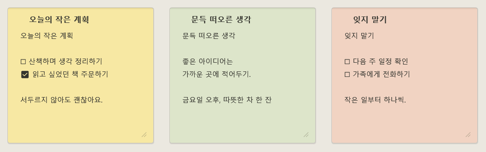
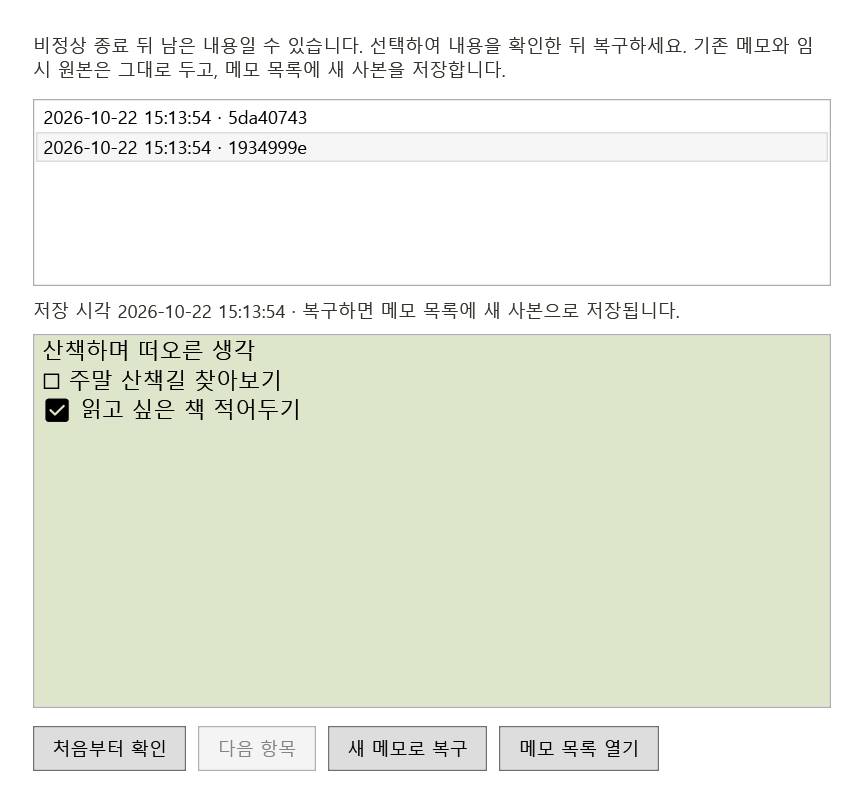
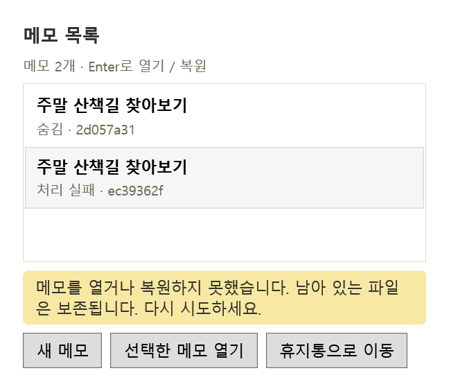
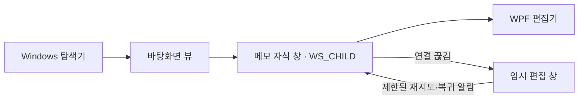
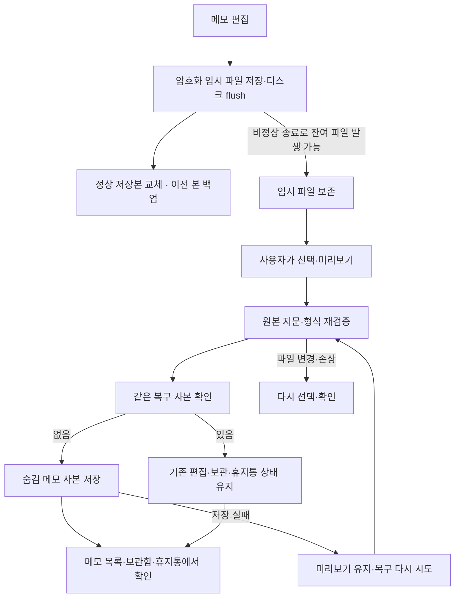

# Windows 데스크톱 메모

바탕화면에 붙여 두고 바로 적는 Windows 메모 앱입니다. 다른 프로그램을 사용할 때는 그 뒤에 놓이고, **Win+D로 바탕화면을 볼 때도 메모를 확인할 수 있도록** 구현했습니다.

**0.9.15 prototype** · Windows 11 x64 · C# / .NET 10 / WPF
현재는 소스에서 빌드하는 개발 버전입니다. 공개 배포와 설치본 업데이트 검증은 진행 중입니다.

[빠른 시작](#빠른-시작) · [사용 방법](#사용-방법) · [저장과 복구](#저장과-복구) · [개발과 검증](#개발과-검증)

## 화면 미리보기



세 가지 종이색과 체크리스트를 지원합니다. 이미지는 시험용 본문을 사용한 **실제 WPF 컨트롤 렌더**입니다. 바탕화면 실행 캡처는 아니며 사용자 데이터는 포함하지 않습니다.



복구 화면도 시험용 데이터로 렌더했습니다. Windows 창 테두리·트레이·Win+D 동작은 포함하지 않습니다. [이미지 출처와 재생성 방법](docs/images/README.md).

목록·보관함·휴지통의 100%·150%·200% 시험 렌더는 CI의 `sample-ui-renders`에 보관합니다. [목록 변경과 검증 범위](docs/results/LIST-07C.md).



열기·복원·휴지통 이동의 진행과 결과를 목록 안에서 확인합니다. 실패하면 원인을 해소한 뒤 같은 버튼으로 다시 시도하세요. 이미지는 0.9.13의 실제 파일 잠금 검사에서 만든 150% WPF 컨트롤 렌더입니다. [검증과 남은 확인](docs/results/LIST-FEEDBACK-07D.md).

## 빠른 시작

**Windows 11 x64**와 **.NET 10 SDK**가 필요합니다. SDK 버전은 [global.json](global.json)에서 관리합니다. 앱은 관리자 권한을 요구하지 않습니다.

프로젝트 루트의 PowerShell에서 실행합니다.

```powershell
dotnet build WindowsMemo.slnx --configuration Release -p:RestoreLockedMode=true
.\src\WindowsMemo\bin\Release\net10.0-windows\WindowsMemo.exe
```

Visual Studio에서는 `WindowsMemo.slnx`를 열고 `WindowsMemo`를 시작 프로젝트로 선택합니다. 메모가 보이지 않으면 알림 영역의 Windows 메모 아이콘을 더블클릭해 목록을 여세요.

바탕화면 부착을 제외하고 편집·저장을 확인하는 일반 창 진단 모드도 있습니다. 별도 데이터 폴더를 사용하며 일반 앱과 동시에 실행할 수 없습니다.

```powershell
.\src\WindowsMemo\bin\Release\net10.0-windows\WindowsMemo.exe --window
```

`dotnet`을 찾지 못하면 SDK 설치 후 PowerShell을 새로 열어 주세요. ZIP·설치 파일 만들기는 [배포 개발 안내](docs/DISTRIBUTION.md)에 분리했습니다.

## 사용 방법

본문을 클릭해 입력하면 자동 저장합니다. 마우스나 키보드 포커스가 들어오면 **+ · 이동 손잡이 · ⋯** 도구를 표시합니다. 기본 크기는 320×300 DIP이며 상단 드래그로 이동하고 오른쪽 아래 손잡이로 크기를 바꿉니다.

| 하고 싶은 일 | 조작 |
| --- | --- |
| 새 메모 | 상단 **+** 또는 트레이 **새 메모** |
| 색상·서식 | **⋯** 또는 **Alt+M** |
| 체크리스트 | 더보기에서 추가, 체크 기호 클릭 또는 **Ctrl+Enter**로 완료 전환 |
| 접기·펼치기 | 더보기 또는 상단 더블클릭 |
| 잠시 숨기기 | 닫기 → 저장 후 숨김, 메모 목록에서 다시 열기 |
| 보관·보관 취소 | 더보기의 보관, 트레이 **보관함**·**보관 실행 취소** |
| 삭제·복원 | 휴지통으로 이동, 트레이 **휴지통**에서 복원 또는 확인 후 영구 삭제 |
| 미완료 내용 복구 | 트레이 **미완료 메모 복구** → 선택 → 미리보기 → **새 메모로 복구** |
| 로그인 때 실행 | 트레이 **로그인 시 자동 실행** — 기본 꺼짐 |
| 앱 종료 | 트레이 **모든 메모 저장 후 종료** |

**숨김·보관·휴지통은 서로 다른 상태**입니다. 마지막 메모를 숨겨도 트레이는 남으며 휴지통은 자동으로 비우지 않습니다. 보관 실행 취소는 현재 실행 중 가장 최근 항목에 적용됩니다.

목록·보관함·휴지통에서는 첫 줄 제목과 상태로 메모를 구분합니다. 제목이 같으면 아래의 짧은 ID를 참고하세요. 항목을 선택하고 버튼이나 **Enter**로 열기·복원할 수 있습니다. 비어 있는 메모는 ‘메모’, 읽을 수 없는 파일은 ‘확인할 수 없는 메모’로 표시합니다. 제목은 별도 평문 파일로 저장하지 않습니다.

입력·서식·위치 변경 후 약 0.5초가 지나면 자동 저장하며, 계속 입력할 때도 최대 5초를 기준으로 저장을 시도합니다. 저장 실패 시 안내와 재시도 버튼을 표시하고 숨김·종료를 취소합니다. 실패 안내가 접힌 메모 안에 숨지 않도록 펼쳐 둡니다.

Windows 로그아웃·종료 요청은 최신 변경의 저장이 완료돼 있으면 바로 허용합니다. 미저장 변경·저장 중·저장 실패가 있으면 이번 요청에 취소 응답을 보내고 비동기로 저장을 준비합니다. **저장 완료 알림 뒤 Windows 종료를 다시 시도하세요.** 앱 준비·다른 작업 중에도 완료 후 재시도해야 합니다. 취소된 요청의 저장 준비만으로 메모 앱이 자동 종료되지는 않습니다. Windows의 강제 종료나 전원 차단에서 미저장 내용을 보장할 수는 없습니다. [상태별 동작·공식 규약·검증](docs/results/SESSION-END-04I.md).

## 바탕화면에 표시하는 방식

기본 메모는 다른 앱 위에 항상 표시되는 창과 구분합니다. `TopMost` 대신 탐색기의 바탕화면 뷰에 자식 창을 붙입니다.



바탕화면 연결이 없으면 임시 창에서 편집·저장을 유지하고 재연결을 시도합니다. 탐색기 내부 창 구조에 의존하므로 Windows 환경별 확인이 필요합니다.

## 저장과 복구

데이터 폴더는 `%LOCALAPPDATA%\WindowsMemo\Notes`입니다. 일반 창 진단 모드는 그 아래 `Diagnostic`을 사용합니다.

- 본문·서식·위치·크기·색상·접힘·숨김·보관 상태를 저장합니다.
- Windows 사용자 계정 범위의 **DPAPI**로 본체·임시 파일·백업을 암호화합니다. 메모를 외부 서버로 전송하지 않습니다.
- 정상 파일 교체 시 이전 저장본 하나를 `.bak`으로 남깁니다. 원본을 읽지 못하면 백업을 검사하고 손상 원본은 보존합니다.
- 기존 스키마 1·2·3을 읽고 스키마 4로 저장합니다. 새 저장 파일을 이전 앱으로 되돌리는 호환성은 지원하지 않습니다.



**미완료 복구는 기존 메모를 덮어쓰지 않습니다.** 선택한 내용과 색상을 새 메모로 저장하고 임시 원본도 남깁니다. 미리보기 뒤 파일이 바뀌거나 읽기·저장에 실패하면 복구를 중단합니다. **0.9.7부터 새로 복구한 사본은 재실행 후에도 인식**합니다. 같은 이름·같은 파일 지문이면 사본을 추가하지 않고, 이미 편집한 내용과 보관·휴지통 상태를 유지한 채 안내합니다.

파일 이름이나 암호화 내용이 달라지면 별도 복구 대상으로 봅니다. 이전 버전에서 만든 사본은 재실행 후 연결 정보를 알 수 없으며 자동으로 합치지 않습니다. 사본을 영구 삭제한 뒤 사용자가 같은 파일을 다시 복구하면 새로 생성할 수 있습니다. [검증과 세부 범위](docs/results/IDENTITY-04F.md).

복구가 실패하면 원인에 맞는 안내를 표시합니다. 일시적인 읽기·저장 실패는 미리보기를 유지하고 **복구 다시 시도**를 제공합니다. 파일이 바뀌었거나 손상된 경우에는 이전 미리보기로 복구하지 않습니다. [재시도 화면](docs/images/recovery-retry.png)과 [검증 기록](docs/results/FEEDBACK-04G.md)을 참고하세요.

| 안내 | 다음 동작 |
| --- | --- |
| 파일이 변경됨·없음 | 파일을 다시 선택하거나 **처음부터 확인**으로 목록 갱신 |
| 사용 중·접근 불가 | 다른 프로그램과 폴더 접근 상태 확인 후 재시도·재선택 |
| 사본 저장 실패 | 저장 공간·폴더 권한 확인 후 **복구 다시 시도** |
| 더 새로운 형식 | 앱을 업데이트한 뒤 확인 |
| 기존 사본 확인 실패 | 메모 목록·보관함·휴지통과 파일 접근 상태 확인 후 재시도 |

시작 시 24시간이 지난 임시 파일 중 정상 저장본과 내용·상태가 같은 중복만 제한적으로 정리합니다. 고유한 내용이나 검증할 수 없는 파일은 자동 삭제·승격하지 않습니다. 복구 목록은 한 번에 최대 64개씩 읽습니다. **다음 항목**으로 계속 탐색하고 **처음부터 확인**으로 새로 조회합니다. 파일이 추가·삭제되는 동안에는 탐색 결과가 달라질 수 있습니다. 날짜 정렬은 각 목록 안에서 적용하며 전체 잔여 파일의 정리 도구는 아닙니다.

복구 후보를 빠르게 바꿀 때는 진행 중인 읽기 하나를 마친 뒤 마지막 선택만 이어서 읽습니다. 이전 선택의 결과·오류는 화면에 표시하지 않고, 페이지 이동·재조회·창 닫기에는 대기 선택을 비웁니다. [작업 수 제한과 검증](docs/results/PREVIEW-04H.md).

암호화는 저장한 Windows 계정과 PC에서 사용하는 것을 전제로 합니다. 다른 계정·PC로 옮기는 내보내기는 아직 없으며 같은 계정의 다른 프로그램이나 화면·클립보드까지 보호하지는 않습니다. [보안 설계](docs/SECURITY.md)에 범위를 설명했습니다.

## 개발과 검증

기존 **WPF UI와 WinForms 트레이**를 유지합니다. 디자인 값은 [NoteTheme.cs](src/WindowsMemo/Views/NoteTheme.cs)에서 관리합니다.

```text
src/WindowsMemo/
  Views/            메모·목록·복구 화면
  Services/         작업공간·창 수명·트레이·자동 저장·RTF
  Infrastructure/   DPAPI·파일 교체·백업·임시 파일 검사
  Interop/          바탕화면 부착·Win32 연동
  Models/           저장 데이터와 창 배치
tests/              격리된 데이터로 실행하는 검증 프로그램
scripts/            개발·패키징·설치 파일 검증
docs/               설계·작업 목록·검증 기록
```

테스트는 실행 프로그램 방식이므로 `dotnet test`로 실행되지 않습니다.

```powershell
dotnet build WindowsMemo.slnx --configuration Release -p:RestoreLockedMode=true
dotnet tests/WindowsMemo.Tests/bin/Release/net10.0-windows/WindowsMemo.Tests.dll
dotnet tests/WindowsMemo.Tests/bin/Release/net10.0-windows/WindowsMemo.Tests.dll --crash-probe

# 복구 창 100회 반복 + 저장 실패 상태 5분 대기 (격리 데이터)
dotnet tests/WindowsMemo.Tests/bin/Release/net10.0-windows/WindowsMemo.Tests.dll --recovery-probe --cycles 100 --idle-seconds 300
```

로그인된 Windows 세션에서는 `--shell-probe`로 실제 바탕화면의 비표시 시험 창 생성·해제를 추가 검증할 수 있습니다. 시험 데이터는 빌드 출력 폴더의 GUID별 디렉터리에 저장하며 사용자 메모 폴더를 사용하지 않습니다.

[Windows CI](.github/workflows/windows-ci.yml)는 PR·main 푸시 시 빌드, 자동 검사, 격리된 자식 프로세스 중단·복구 시험, 짧은 복구 창 수명 시험을 수행합니다. 시험용 UI 렌더와 수명 측정 JSONL을 artifact로 보관합니다. 수명 시험은 비표시 창으로 실행하며 실제 화면 입력이나 장시간 상주 시험을 대신하지 않습니다.

### 현재 확인 범위

| 구분 | 확인 내용 |
| --- | --- |
| 0.9.15 로컬 빌드·검사 | Release 경고·오류 0, **150개**(자동 149개 + 실제 비표시 호스트 1개) 통과. 배포 검증 스크립트는 실행 정책 차단으로 로컬 미실행, 정적 구문 검사 통과. [아카이브 검증 기록](docs/results/ARCHIVE-10A2.md) |
| 이전 기능 검증 | [업데이트 캐시 보존](docs/results/UPDATE-CACHE-10B2C.md), [목록 안내·화면 렌더](docs/results/LIST-FEEDBACK-07D.md), [폐기 후 비동기 완료](docs/results/DISPOSAL-12C.md), [세션 종료·저장 순서](docs/results/SESSION-END-04I.md). 버전별 로컬 실행 여부와 원격 CI 결과는 각 기록에 보관 |
| 이전 0.9.8 복구 창 수명·대기 | 100회 반복 후 잔존 창·문서 참조 0개, 5분 대기 중 원본 파일 불변, 대기 후 저장 재시도 통과. [측정 수치와 한계](docs/results/RECOVERY-LIFETIME-12B.md) |
| 수동 확인이 남은 항목 | 실제 Windows 로그아웃/종료·취소/재시도, Win+D·한글 조합·혼합 DPI·탐색기/절전 복귀·가상 데스크톱·게시자 인증/서명·설치본 업데이트·8/24시간 상주 |

자동 검사와 비표시 창 검증은 실제 화면·입력·장시간 안정성 시험을 대신하지 않습니다. 이전 성능·수명 측정과 한계는 [중간 점검 기록](docs/results/REVIEW-14.md)에서 확인할 수 있습니다.

## 더 알아보기

- [요구사항](docs/REQUIREMENTS.md) · [설계](docs/DESIGN.md) · [작업 목록](docs/BACKLOG.md)
- [검증 계획](docs/VALIDATION.md) · [안정성 설계](docs/STABILITY.md) · [보안 설계](docs/SECURITY.md)
- [개발 안내](docs/DEVELOPMENT.md) · [배포 개발 안내](docs/DISTRIBUTION.md) · [버전·업데이트 계획](docs/RELEASES.md)

현재 별도 라이선스 파일은 추가하지 않았습니다.
