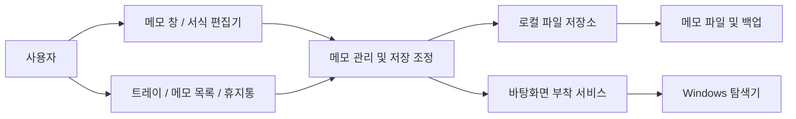

# 초기 설계

이 문서는 전체 제품의 초기 설계다. 현재 Program, NoteView, DesktopNoteHost 및 NativeMethods로 첫 시제품을 구현했다. 저장 모델·MVVM·트레이 등 나머지는 계획이다. 요구사항은 `REQUIREMENTS.md`, 작업 상태는 `BACKLOG.md`, 실제 구조는 README를 기준으로 한다.

## 기술 및 의존성 방향

- C# + WPF, net10.0-windows 및 .NET SDK 10.0.401을 첫 시제품에 사용한다. SDK는 global.json에 고정했다.
- WPF `RichTextBox`와 `FlowDocument`로 서식을 구현한다. 편집기 기능은 WPF 화면 계층에 둔다.
- Windows 연동은 Win32 호출을 별도 서비스로 격리한다.
- 트레이는 Windows Forms `NotifyIcon` 사용을 우선 검토한다. 메모 UI는 WPF로 유지한다.
- 초기에는 서버, DB, 외부 UI 프레임워크 없이 시작한다. 필요성이 생기기 전까지 의존성을 늘리지 않는다.

RichTextBox는 WPF의 서식 편집 컨트롤이다. 저장용 RTF 변환은 구현 시 실제 왕복 보존 테스트로 확인한다. 참고: [RichTextBox 개요](https://learn.microsoft.com/en-us/dotnet/desktop/wpf/controls/richtextbox-overview).

## 바탕화면 부착 검증

첫 시제품에서는 탐색기의 SHELLDLL_DefView를 부모로 HwndSource 자식 창을 생성했다. SetParent로 기존 WPF Window를 변경하지 않았다. 현재 사용자 PC에서 Win+D 유지 및 편집을 확인했다. 아래 내용은 선택지 검토와 후속 안정성 검증의 기준이며 전체 Windows 지원을 의미하지 않는다.

0.2.0에서는 연결 손실 시 같은 편집기를 임시 일반 창으로 옮기고 최대 10회 재연결한다. 숨겨진 알림용 창과 2초 타이머는 호스트가 관리한다. 작업 영역은 모니터와 바탕화면 부모 영역의 교차 범위로 제한한다. 실제 재시작·혼합 배율 검증은 남아 있으며 결과는 results/RECOVERY-02.md를 따른다.

탐색기의 바탕화면 창 구성을 조사하여 메모 창을 부착할 수 있는지 확인한다. `Progman`/`WorkerW` 계열 창 탐색은 실험 후보이며, 모든 Windows 버전에서 보장된 계약으로 취급하지 않는다. 데스크톱 아이콘 뒤에 가려지거나 포커스를 얻지 못하는 구현은 요구사항을 만족하지 않는다.

1. WPF 창의 핸들을 확보하고 현재 창 스타일·부모·좌표를 기록한다.
2. 대상 바탕화면 창을 찾아 부착 전략을 실험한다.
3. Win+D, 작업 표시줄 버튼, 한글 입력, 서식 도구 포커스를 실제 확인한다.
4. 창 스타일, 좌표 변환, 화면 배율 문제를 기록한다.
5. 탐색기 재시작 후 유효하지 않은 핸들을 폐기하고 새 대상을 탐색하는 복구를 후속 구현한다.

`SetParent`는 창 스타일을 자동 변경하지 않으며, 서로 다른 DPI 인식 모드에서 오류나 예상하지 못한 동작이 생길 수 있다. 단순 호출만으로 성공을 판정하지 않는다. 참고: [SetParent](https://learn.microsoft.com/en-us/windows/win32/api/winuser/nf-winuser-setparent), [WPF와 Win32 연동](https://learn.microsoft.com/en-us/dotnet/desktop/wpf/advanced/wpf-and-win32-interoperation).

부착 실패 시 정상 동작으로 위장하지 않는다. 실패 상태와 재시도 방법을 제공하고, 편집 중인 내용은 유지한다. 일반 창으로 제공하는 진단 모드는 핵심 요구사항 충족으로 계산하지 않는다.

## 구성과 데이터 흐름

처음에는 앱 프로젝트 하나와 테스트 프로젝트 하나로 시작한다. 레이어 분리는 폴더와 역할로 수행하며 프로젝트를 과도하게 나누지 않는다.



| 구성 후보 | 역할 |
| --- | --- |
| App | 시작·종료, 단일 실행 인스턴스, 서비스 및 트레이 수명 관리 |
| NoteWindow / EditorAdapter | 창, 입력, 서식 명령, RTF 직렬화와 복원 |
| NoteViewModel | 메모 상태와 화면 명령. HWND 및 FlowDocument를 저장 모델에 포함하지 않음 |
| NoteCoordinator | 생성·숨김·삭제·복원, 창과 메모 ID 연결 |
| AutosaveCoordinator | 변경 버전 추적, 지연 저장, 저장 순서 및 실패 상태 관리 |
| FileNoteRepository | 파일 읽기·쓰기, 버전 검증, 백업과 복구 |
| DesktopAttachmentService | 부착·해제·재탐색·복구. 창 핸들과 Win32 호출 관리 |
| TrayService / StartupService | 트레이 명령 및 로그인 자동 실행 설정 |

편집기는 WPF UI 스레드에서 서식 문서를 직렬화한다. 불변 스냅샷을 저장 서비스에 전달한 뒤 파일 작업을 수행한다. 백그라운드에서 WPF 문서를 직접 수정하거나 읽지 않는다.

## 저장 모델

초기 설계는 메모별 암호화 JSON 봉투 파일이다. 본문 RTF와 메타데이터를 한 내부 레코드로 직렬화하고 Windows DPAPI CurrentUser로 보호한 뒤 암호문을 봉투에 저장한다. Base64 자체는 암호화가 아니다. 사용자 답변에 따라 평문 저장안을 변경했으며 임시 파일과 백업도 암호화한다. 세부 형식과 입력 제한은 `SECURITY.md`를 따른다.

데이터 루트 후보는 `%LOCALAPPDATA%\WindowsMemo`다. 제품명 결정 시 경로를 확정하며 소스 폴더나 실행 파일 옆에 사용자 메모를 저장하지 않는다.

자동 업데이트 도구의 설치 루트와 이 데이터 루트가 겹치지 않도록 확정한다. 버전·배포 및 데이터 이전 설계는 `RELEASES.md`를 따른다.

| 필드 후보 | 의미 |
| --- | --- |
| schemaVersion | 저장 형식 버전 |
| id | 변경하지 않는 메모 식별자 |
| contentFormat / content | RTF 형식 표시와 Base64 본문 |
| createdAtUtc / updatedAtUtc | 생성·변경 시각 |
| deletedAtUtc | 삭제 시각. 없으면 일반 메모 |
| isVisible | 재시작 시 표시 여부 |
| bounds / monitorHint | 창 위치·크기 및 모니터 배치 복원 정보 |

위 필드는 암호화되는 내부 레코드다. 외부 봉투는 봉투 버전·보호 방식·암호문만 포함한다. 복호화 및 스키마 검증 실패 시 원본을 보존한다.

창 위치는 WPF의 DIP 단위로 관리하되 부착 시 부모 클라이언트 좌표와 물리 픽셀의 변환을 분리한다. 화면 밖으로 벗어난 메모는 연결된 모니터의 보이는 영역으로 이동한다.

휴지통은 동일 메모의 삭제 상태로 표현한다. 복원은 삭제 상태를 해제한다. 자동 영구 삭제는 하지 않는다. 목록은 메모 파일에서 재구성하여 별도 인덱스와 본문의 불일치를 줄인다.

## 저장과 복구 규칙

- 입력·서식 변경 후 약 500ms의 지연 저장을 기본값으로 시작한다. 긴 입력 중에도 주기적으로 저장하도록 최대 대기 시간을 둔다.
- 메모별 저장을 직렬화하고 변경 버전을 추적한다. 이전 스냅샷 저장이 끝나도 새 변경을 저장 완료로 표시하지 않는다.
- 임시 파일 쓰기와 닫기를 완료한 뒤 교체하고 이전 정상본을 백업한다. 동일 데이터 볼륨에서 교체 동작과 실패 복구를 검증한다.
- 숨김, 삭제, 앱 종료 시 최신 변경 저장을 요청한다. 저장 실패를 조용히 무시하지 않는다.
- 시작 시 손상된 파일을 빈 메모로 덮어쓰지 않는다. 백업 복구를 시도하고 실패 시 원본을 보존한 채 오류를 알린다.
- 최초 버전에서는 메모 파일당 이전 정상본 하나를 보관한다. 장기 백업이나 다른 PC로 이동하는 기능은 별도 설계한다.
- 두 앱 인스턴스가 같은 저장소를 동시에 수정하지 않도록 단일 실행 인스턴스로 구성한다.
- 편집 가능한 동안 이미 저장 완료된 데이터의 복원을 보장한다. 강제 종료·정전 직전의 미저장 변경 보존까지 보장한다고 표기하지 않는다.

## 화면과 수명

메모 창은 이동 영역, 본문, 간단한 서식 도구, 새 메모·숨김·삭제 동작으로 구성한다. 편집 도구를 클릭해도 본문 선택 영역을 유지한다. 메모 목록과 휴지통은 트레이에서 여는 일반 관리 창으로 둔다.

창 닫기와 앱 종료를 분리한다. 마지막 메모를 숨겨도 트레이와 앱은 살아 있다. 실제 종료는 트레이 메뉴에서 수행한다. 로그인 자동 실행은 기본 꺼짐으로 시작한다.

숨긴 메모는 저장 성공 후 창과 편집기를 실제 폐기하고 표시 시 재생성하는 방향으로 설계한다. 저장 실패 상태의 최신 본문은 유지한다. 이벤트·훅·타이머와 네이티브 리소스의 소유 및 해제 규칙은 `STABILITY.md`를 따른다.

## 제안 디렉터리

최종 역할별 구조 제안이다. 현재 생성된 폴더와 파일은 README를 따른다.

```text
src/WindowsMemo/
  Views/             메모·목록·휴지통·설정 화면
  ViewModels/        화면 상태와 명령
  Models/            저장 가능한 메모 및 설정
  Services/          메모 수명, 자동 저장, 직렬화
  Infrastructure/    파일 저장, 트레이, 자동 실행
  Interop/           Windows API와 바탕화면 부착
tests/WindowsMemo.Tests/
  저장·복구·상태 전이 등 자동 검증
```

## 개발 환경 확인 결과

개발 착수 시 추가 확인: 기본 경로에 SDK 10.0.401 및 WindowsDesktop 런타임 10.0.12가 설치되어 있었다. PATH가 갱신되지 않은 셸에서는 절대 경로를 사용했다. 실제 SDK 조회는 OS Version 10.0.26200으로 반환했고 WPF 빌드 및 로컬 실행을 완료했다. 아래는 최초 조사 기록이다.

2026-10-13 현재 셸에서 `dotnet --info`는 명령을 찾지 못했다. 미설치인지 PATH 문제인지는 아직 확정하지 않았다. x64와 레지스트리 값 DisplayVersion `25H2`, CurrentBuild `26200`, UBR `9457`을 확인했다. 레지스트리 ProductName은 `Windows 10 Home`으로 반환되어 사용자 답변과 달랐으므로, 실제 OS 표시명은 개발 시작 시 설정 화면 등으로 추가 확인한다. 초기 지원 목표는 사용자가 선택한 Windows 11이다.
