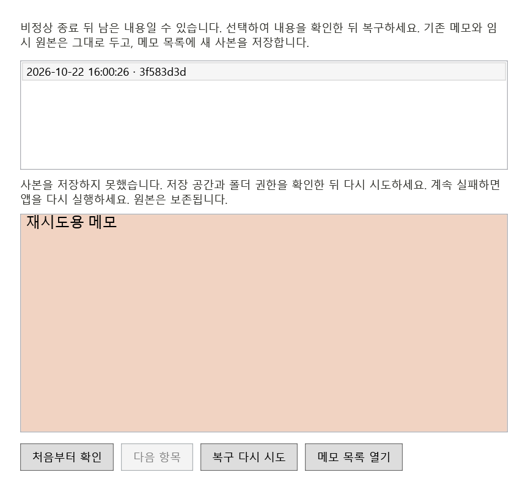

# WM-004G — 복구 실패 안내와 재시도

2026-10-22, 0.9.8 prototype, SDK 10.0.401. PR #8 병합본 57c063c에서 분리했다. WPF·WinForms 트레이·스키마 4·DPAPI·복구 ID v1·사용자 저장 경로는 유지한다.

## 변경

복구 결과에 성공/기존 사본 외에 진행 중·원본 변경·원본 없음·읽기 불가·내용 확인 실패·미래 형식·기존 사본 확인 실패·메모 한도·사본 저장 실패를 명시한다. 반환값 하나로 성공 여부와 재시도 가능 여부를 판단하고, UI에는 정해진 한국어 안내만 표시한다. 예외 원문·경로·본문은 안내나 새 로그에 넣지 않는다.

저장/접근 같은 재시도 가능한 실패에서는 선택과 읽기 전용 미리보기를 유지하고 **복구 다시 시도**를 표시한다. 매번 파일을 다시 읽어 지문·암호화·스키마·RTF를 검증하며 메모리를 그대로 저장하지 않는다. 파일 변경·없음·손상·미래 형식에서는 미리보기와 선택을 비우고 복구를 비활성화한다. 처음 읽기 실패 때도 선택을 비워 같은 행을 다시 선택할 수 있게 한다. 목록 이동·재조회·창 닫기에는 기존 미리보기 무효화와 핸들 해제를 유지한다.

기존 사본의 과거 실패 표시만으로 복구 요청을 계속 거부하지 않는다. 현재 파일을 다시 검증하고 성공했을 때 상태와 오류 표시를 갱신하며, 본문·보관·휴지통·백업을 다시 쓰지 않는다. 1,000개 한도에서도 이미 있는 사본은 확인할 수 있고 새 생성만 제한한다. 원본·기존 사본 자동 삭제나 별도 이력 파일·타이머·의존성은 추가하지 않는다.

## 검증

- Release 경고/오류 0, 로컬 **118개 PASS**(자동 117개 + 실제 바탕화면 비표시 호스트 1개).
- 실제 임시 파일 삭제·변경·독점 잠금과 DPAPI로 암호화한 손상 RTF/미래 스키마를 사용해 구분된 결과·재시도 정책·파일 불변을 확인했다. 안내에 시험 본문과 경로가 노출되지 않음을 검증했다.
- 생성 대상 경로에 시험용 빈 디렉터리를 만들어 실제 파일 저장을 실패시킨 후, 같은 미리보기로 장애 제거→재시도→새 사본 저장을 확인했다. 사용자 저장 폴더의 권한·여유 공간은 변경하지 않았다. 실제 디스크 부족/ACL 전체 조합을 시험한 것으로 표시하지 않는다.
- 손상된 사본으로 초기화해 오류 표시가 있는 상태에서 복구 거부·원본 보존을 확인한 뒤, 시험 파일을 정상 바이트로 돌려놓고 재실행 없이 기존 ID 재인식·오류 해제·파일 불변을 확인했다.
- 숨긴 메모 1,000개의 실제 저장소로 기존 복구 사본 확인 성공과 새 스냅샷 생성 제한을 확인했다.
- UI에서 저장 실패 후 선택/본문/원본 유지·재시도 버튼, 성공 후 선택 정리, 변경된 본문의 복구 차단, 읽기 실패 후 같은 행 재선택을 확인했다. 창 20회 생성·폐기 후 참조 회수와 탐색 핸들 수명 검사도 통과했다. 장시간 누수 부재를 보장하지 않는다.
- 격리 자식 프로세스 중단·복구 **10건 PASS**(기존 8건 + 사본 저장 직전/직후 2건), 새 읽기 프로세스의 중복 방지·원본 보존을 유지했다. JSONL: `artifacts/recovery-feedback-validation/bin/WindowsMemo.Tests/release/crash-probe/f65efbf75f114465ae51feff1db43d53/results.jsonl`.



위 이미지는 시험용 데이터의 실제 WPF 컨트롤 렌더로, 바탕화면 캡처가 아니다. 직접 열어 한글·안내·본문·버튼 배치를 확인했다. SHA256: recovery-retry.png `8c19330eee7ffb0e89247924f32855669f610009b04946b6adedc6096cb0d979`, pending-recovery.png `95acf342023bf667ed7859d8162ee4ac3ecd2344e20c34c31e2f25ee1e4b9741`.

```powershell
dotnet build WindowsMemo.slnx --configuration Release -p:RestoreLockedMode=true --artifacts-path artifacts/recovery-feedback-validation
dotnet artifacts/recovery-feedback-validation/bin/WindowsMemo.Tests/release/WindowsMemo.Tests.dll --shell-probe
dotnet artifacts/recovery-feedback-validation/bin/WindowsMemo.Tests/release/WindowsMemo.Tests.dll --crash-probe
```

시험 파일은 출력 경로의 GUID별 디렉터리에 한정했다. 사용자 메모·실행 중 사용자 앱·Explorer·보안 설정은 변경하지 않았다. 실제 Win+D·IME·혼합 DPI·권한 정책/장치 장애·전원 차단·링크/정션 조합·설치본·8/24시간 상주는 수동 확인 항목이다. 고유 임시 파일의 전체 보존/삭제 정책은 후속이다.
